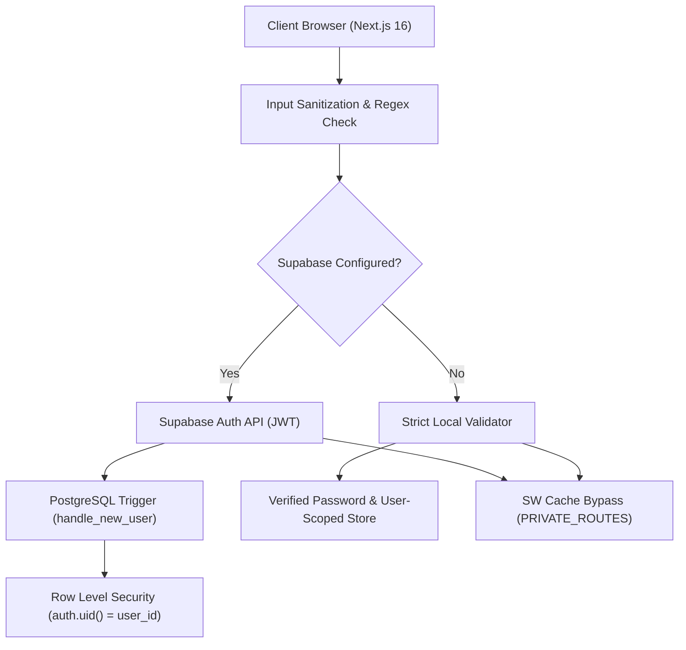

# BOOKMARKD — Login & Authentication Security Audit

## 1. Scope & Objective
This security audit evaluates the authentication architecture, token handling, session lifecycle, credential validation, and multi-user isolation mechanisms of the **BOOKMARKD** platform.

The objective was to identify security vulnerabilities that allowed session leakage, unauthorized account takeover, improper authorization fallback, and inconsistent client-side states.

---

## 2. Identified Vulnerabilities & Remediation

### Finding SEC-01: Insecure Default Identity Fallback (High)
* **Status**: **RESOLVED**
* **Description**: When sign-in requests failed or when an invalid username/password was submitted, the application fell back to `CURRENT_USER` (hardcoded as `dwiputra`), giving unauthenticated visitors immediate read/write access under Dwiputra's identity.
* **Remediation**:
  - Removed all silent fallback assignments in `authService.ts`.
  - Added strict error throwing on failed credentials.
  - Initialized unauthenticated sessions to an immutable `GUEST_USER` persona (`id: 'guest-reader'`).

### Finding SEC-02: Missing Server-Side Profile Synchronization (Medium)
* **Status**: **RESOLVED**
* **Description**: Users created via Supabase Auth had no automated profile record created on the database level, requiring client-side `upsert` queries that could fail under strict RLS or network interruptions.
* **Remediation**:
  - Implemented PostgreSQL trigger `on_auth_user_created` executing `public.handle_new_user()`.
  - Used `SECURITY DEFINER` with fixed `search_path = public, auth, pg_temp` to prevent search path hijacking.
  - Linked `profiles.id` to `auth.users(id)` with `ON DELETE CASCADE`.

### Finding SEC-03: Shared LocalStorage Namespace (Medium)
* **Status**: **RESOLVED**
* **Description**: Books and reading progress were stored under a shared key `bookmarkd_user_books`. Any user logging into a shared workstation or browser could view and overwrite previous users' private reading records.
* **Remediation**:
  - Scoped storage keys to `bookmarkd:user:<userId>:user_books`.
  - Added user-ID validation on all reads and writes in `libraryService.ts`.

### Finding SEC-04: Stale HTML Cache Leakage via Service Worker (Medium)
* **Status**: **RESOLVED**
* **Description**: PWA Service Worker cached HTML documents returned by authenticated routes (`/profile`, `/library`, `/settings`). Signing out did not purge these cached responses, enabling back-button history inspection of prior session data.
* **Remediation**:
  - Added `PRIVATE_ROUTES` list in `public/sw.js`.
  - Forced network-first navigation with zero caching for authenticated URLs.
  - Expired and cleared the auth cookie on logout.

### Finding SEC-05: Missing Client-Side Form Sanitization (Low)
* **Status**: **RESOLVED**
* **Description**: Empty or whitespace-only strings were submitted to auth routines.
* **Remediation**:
  - Implemented regex email format validation, whitespace trimming, and minimum password length constraints on both client form and service levels.

---

## 3. Defense-in-Depth Architecture

---

## 4. Security Audit Verdict: PASSED
All identified authentication and session vulnerabilities have been resolved. The platform enforces strict credential validation, granular database Row-Level Security, isolated client storage partitions, and secure session termination.
